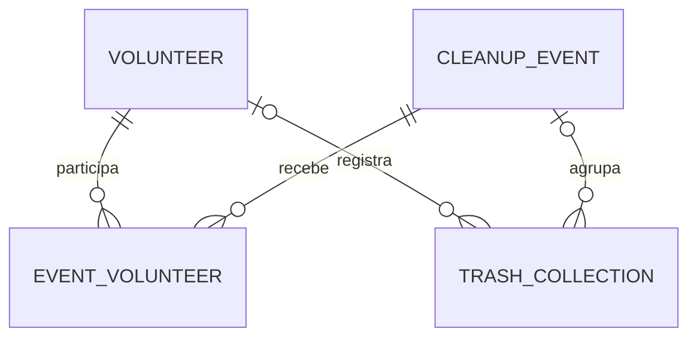

# Análise do projeto Beachcleanup

Data da análise: 07/10/2026.

## 1. Escopo e conclusão geral

O projeto é uma API REST Spring Boot para gerenciar voluntários, eventos de limpeza de praias e registros de coleta de resíduos. A arquitetura em camadas e os relacionamentos JPA estão definidos, com métodos básicos de CRUD nas três áreas. Entretanto, a presença desses métodos não significa que todos os fluxos funcionem corretamente: existem erros no recebimento de requisições, na atualização de dados e na proteção das senhas.

A análise considera o conteúdo atual dos arquivos, inclusive alterações locais que já existiam antes desta revisão. Não foram modificados arquivos existentes. A avaliação é estática: não foram executados Maven, testes, inicialização da aplicação ou chamadas HTTP. Assim, compilação, resolução das dependências e comportamento efetivo em execução não foram validados. Os defeitos abaixo são sustentados pelo código; resultados dependentes do framework são indicados como riscos a confirmar em testes.

## 2. Estrutura geral do projeto

```text
beachcleanup/
├── pom.xml
├── mvnw / mvnw.cmd
├── .mvn/wrapper/maven-wrapper.properties
├── .gitignore / .gitattributes
├── .project / .classpath / .settings/  (configuração local Eclipse)
├── HELP.md                           (guia genérico, ignorado pelo Git)
├── src/main/java/com/raphael/beachcleanup/
│   ├── BeachcleanupApplication.java
│   ├── config/
│   │   └── TestConfig.java
│   ├── entities/
│   │   ├── Volunteer.java
│   │   ├── CleanupEvent.java
│   │   └── TrashCollection.java
│   ├── repositories/
│   │   └── VolunteerRepository, CleanupEventRepository, TrashCollectionRepository
│   ├── services/
│   │   └── VolunteerService, CleanupEventService, TrashCollectionService
│   ├── resources/
│   │   └── VolunteerResource, CleanupEventResource, TrashCollectionResource
│   ├── dto/
│   │   └── VolunteerDTO, VolunteerInsertDTO
│   └── exceptions/
│       └── ResourceNotFoundException, ResourceExceptionHandler,
│           StandardError, ValidationError, FieldMessage
├── src/main/resources/
│   ├── application.properties
│   └── application-test.properties
└── src/test/java/com/raphael/beachcleanup/
    └── BeachcleanupApplicationTests.java
```

O fluxo principal é `Controller (resources) → Service → Repository → banco`. As classes usam injeção de dependências por campo com `@Autowired`. A classe `BeachcleanupApplication`, anotada com `@SpringBootApplication`, está no pacote raiz e inicia a aplicação.

Os controllers estão no pacote `resources` e usam `@RestController`. DTOs são usados parcialmente no módulo de voluntários. Não há frontend, templates, recursos estáticos, scripts de migração, configuração de segurança, documentação OpenAPI, Dockerfile ou pipeline de CI nos arquivos examinados.

## 3. Entidades e relacionamentos JPA

### 3.1. Entidades

As três entidades implementam `Serializable`, têm construtor vazio, identificador `Long` com `@Id` e geração `GenerationType.IDENTITY`. Seus métodos `equals` e `hashCode` usam o identificador.

| Entidade | Nome declarado em `@Table` | Campos escalares |
|---|---|---|
| `Volunteer` | `tb_volunteer` | `id`, `name`, `email`, `password`, `totalTrashCollecting` (`Double`) |
| `CleanupEvent` | `tb_cleanupEvent` | `id`, `title`, `location`, `dateTime` (`LocalDateTime`), `status` (`String`) |
| `TrashCollection` | `tb_trash_collection` | `id`, `beach`, `materialType`, `weithKg` (`Double`), `regitrationDate` (`LocalDate`) |

Os nomes da tabela acima são os declarados no código. A grafia física final de tabelas e colunas deve ser confirmada no DDL gerado, pois pode sofrer transformação pela estratégia de nomes do Hibernate.

Não há restrições explícitas `@Column(nullable = false)`, unicidade do e-mail, limites de tamanho, precisão numérica ou validações nas entidades. `status` e `materialType` são textos livres. `LocalDateTime` não carrega fuso horário; o contrato temporal precisa ser definido caso existam clientes em diferentes fusos.

### 3.2. Relacionamentos

| Origem | Destino | Mapeamento | Responsabilidade |
|---|---|---|---|
| `Volunteer.events` | `CleanupEvent` | `@ManyToMany` | Lado proprietário da tabela associativa |
| `CleanupEvent.volunteers` | `Volunteer` | `@ManyToMany(mappedBy = "events")` | Lado inverso |
| `Volunteer.collection` | `TrashCollection` | `@OneToMany(mappedBy = "volunteer")` | Lado inverso |
| `CleanupEvent.collection` | `TrashCollection` | `@OneToMany(mappedBy = "event")` | Lado inverso |
| `TrashCollection.volunteer` | `Volunteer` | `@ManyToOne`, FK `volunteer_id` | Lado proprietário |
| `TrashCollection.event` | `CleanupEvent` | `@ManyToOne`, FK `event_id` | Lado proprietário |

`Volunteer.events` declara a tabela associativa `tb_event_volunteer`, com `volunteer_id` e `event_id`.



As ligações de uma coleta com voluntário e evento não foram declaradas obrigatórias: não há `optional = false` nem `nullable = false` nas associações. O diagrama representa essa possibilidade de ausência. Também não há regra que exija que o voluntário da coleta esteja inscrito no evento correspondente.

Não foram configurados `cascade`, `orphanRemoval` ou `fetch` explicitamente. Pelos padrões JPA, `ManyToMany` e `OneToMany` são LAZY e `ManyToOne` é EAGER. Excluir um voluntário ou evento com vínculos exige uma política de negócio; não há exclusão automática de todas as relações declarada no modelo.

### 3.3. Serialização e consistência

- `@JsonIgnore` oculta `Volunteer.collection`, `CleanupEvent.volunteers` e `CleanupEvent.collection`, interrompendo os principais ciclos de serialização.
- `Volunteer.events`, `Volunteer.password`, `TrashCollection.volunteer` e `TrashCollection.event` continuam expostos quando as entidades são retornadas diretamente.
- `CleanupEvent.collection` não tem getter público; o mapeamento JPA continua válido porque as anotações estão nos campos, mas a navegação pela API Java é limitada.
- Não existem métodos auxiliares que sincronizem os dois lados das associações. O seed altera o lado proprietário `Volunteer.events`, suficiente para gravar a tabela associativa, mas não atualiza explicitamente a coleção inversa em memória.
- Duas entidades novas da mesma classe com `id = null` são consideradas iguais pelo `equals` atual. Isso pode eliminar elementos de um `HashSet`; atribuir o ID também muda o `hashCode`. Convém revisar essa estratégia.

## 4. Repositories

| Interface | Tipo gerenciado |
|---|---|
| `VolunteerRepository` | `JpaRepository<Volunteer, Long>` |
| `CleanupEventRepository` | `JpaRepository<CleanupEvent, Long>` |
| `TrashCollectionRepository` | `JpaRepository<TrashCollection, Long>` |

As interfaces estão vazias e aproveitam operações herdadas, como `findAll`, `findById`, `save`, `saveAll`, `deleteById` e `getReferenceById`. O Spring Data fornece suas implementações.

Não há consultas próprias, métodos derivados para busca por e-mail, filtros de eventos/coletas, agregações de peso ou verificações de inscrição. A infraestrutura herdada suporta paginação, mas os services e endpoints atuais usam `findAll()` sem paginação.

## 5. Services

Os três services têm `@Service` e métodos `findAll`, `findById`, `insert`, `delete`, `update` e `updateData`.

| Service | Consulta individual | Inserção/exclusão | Campos copiados na atualização |
|---|---|---|---|
| `VolunteerService` | `orElseThrow(ResourceNotFoundException)` | Delegação a `save` e `deleteById` | Nome é definido duas vezes: primeiro com `name`, depois com `email` |
| `CleanupEventService` | `Optional.get()` | Delegação a `save` e `deleteById` | `location`, `dateTime`, `status` |
| `TrashCollectionService` | `Optional.get()` | Delegação a `save` e `deleteById` | `weithKg`, `beach`, `materialType` |

As atualizações usam `getReferenceById`, alteram a entidade e chamam `save`. Não existe `@Transactional` explícito na camada de serviço. Os métodos dos repositories têm sua própria infraestrutura transacional, mas não há fronteira de transação de negócio abrangendo várias operações.

Problemas e limitações:

- `VolunteerService.updateData` chama `entity.setName(obj.getEmail())` em vez de atualizar o e-mail. O nome final passa a ser o e-mail recebido e o e-mail original permanece.
- O título do evento não é atualizado. A data de registro e as associações da coleta também não são atualizadas. É necessário definir se são campos imutáveis ou funcionalidades ausentes.
- Atualizações podem substituir valores existentes por `null` quando o corpo omite campos copiados; não há semântica de atualização parcial definida.
- Não há cálculo de `totalTrashCollecting`, checagem de peso positivo, controle de e-mail duplicado, verificação de vínculos ou regras de transição de status.
- Somente a busca individual de voluntário converte ausência em uma exceção própria. Atualizações e exclusões não padronizam essa situação.

## 6. Controllers e endpoints

Os status abaixo descrevem as respostas de sucesso construídas pelo código. Não representam confirmação de funcionamento por testes HTTP. Não há configuração explícita de porta ou context path nos arquivos analisados.

### 6.1. `VolunteerResource` — `/volunteers`

| Método | Endpoint | Entrada | Resposta de sucesso |
|---|---|---|---|
| GET | `/volunteers` | — | 200, lista de `VolunteerDTO` |
| GET | `/volunteers/{id}` | ID no caminho | 200, entidade `Volunteer` |
| POST | `/volunteers` | JSON `VolunteerInsertDTO`, com `@Valid` | 201, `Location` e `VolunteerDTO` |
| DELETE | `/volunteers/{id}` | ID no caminho | 204, sem corpo |
| POST | `/volunteers/{id}` | JSON `Volunteer` | 200, entidade atualizada |

`VolunteerDTO` contém `id`, `name`, `email` e `totalTrashCollecting`, omitindo senha e associações. O cadastro cria a entidade com ID nulo e total inicial `0.0`. O DTO de entrada exige nome, e-mail e senha não vazios, além de formato de e-mail válido.

A busca individual e a atualização retornam a entidade, incluindo `password`. Não há `@Valid` na atualização. O setter da senha do DTO de entrada é `setPassoword`, com erro de grafia; a propriedade JavaBean fica inconsistente. O efeito na desserialização depende da configuração do Jackson e deve ser confirmado, sem presumir que o cadastro sempre falhe por esse motivo.

### 6.2. `CleanupEventResource` — `/cleanupEvent`

| Método | Endpoint | Entrada declarada | Resposta de sucesso construída |
|---|---|---|---|
| GET | `/cleanupEvent` | — | 200, lista de `CleanupEvent` |
| GET | `/cleanupEvent/{id}` | ID no caminho | 200, entidade |
| POST | `/cleanupEvent` | `@PathVariable CleanupEvent obj` | 200, entidade; cadastro com anotação incorreta |
| DELETE | `/cleanupEvent/{id}` | ID no caminho | 204, sem corpo |
| POST | `/cleanupEvent/{id}` | JSON `CleanupEvent` | 200, entidade atualizada |

O cadastro anota a entidade com `@PathVariable`, embora a rota não declare uma variável para esse parâmetro. Assim, o método não recebe o JSON como corpo; deveria utilizar `@RequestBody`. A URI do novo recurso é calculada, mas não é usada na resposta. Não há validação de título, local, data ou status.

### 6.3. `TrashCollectionResource` — `/trashCollection`

| Método | Endpoint | Entrada declarada | Resposta de sucesso construída |
|---|---|---|---|
| GET | `/trashCollection` | — | 200, lista de `TrashCollection` |
| GET | `/trashCollection/{id}` | ID no caminho | 200, entidade |
| POST | `/trashCollection` | `@PathVariable TrashCollection obj` | 200, entidade; cadastro com anotação incorreta |
| DELETE | `/trashCollection/{id}` | ID no caminho | 204, sem corpo |
| POST | `/trashCollection/{id}` | JSON `TrashCollection` | 200, entidade atualizada |

O cadastro tem o mesmo erro de `@PathVariable` e a mesma URI calculada sem utilização. As respostas incluem voluntário e evento associados; o voluntário aninhado pode expor sua senha. Não há validação do peso, do material, da praia, da data ou dos IDs relacionados.

### 6.4. Contrato HTTP e erros

As três rotas de atualização usam POST. Recomenda-se definir PUT para substituição ou PATCH para atualização parcial. As rotas também misturam plural e singular em camelCase; uma padronização pode melhorar o contrato, mas exige considerar consumidores existentes.

`ResourceExceptionHandler`, com `@ControllerAdvice`, trata apenas `ResourceNotFoundException`, retornando 404 com `StandardError`: `timestamp`, `status`, `error`, `message` e `path`.

`ValidationError` e `FieldMessage` estão criados, mas não são utilizados pelo handler. A validação do cadastro de voluntário está acionada por `@Valid`; falta adaptar seus erros ao formato próprio. Não há tratamento específico para integridade referencial, conflitos, JSON inválido ou falhas de atualização por ID inexistente. As buscas inexistentes de evento/coleta chamam `Optional.get()`, gerando `NoSuchElementException`, sem conversão explícita para 404.

## 7. Configuração do banco de dados

### 7.1. Configuração geral

Em `src/main/resources/application.properties`:

```properties
spring.application.name=beachcleanup
spring.profiles.active=test
spring.jpa.open-in-view=true
```

O perfil `test` está ativo por padrão. `open-in-view=true` mantém o contexto de persistência disponível durante a requisição, o que permite carregar associações durante a serialização, mas pode produzir consultas fora dos services e dificultar o controle de desempenho.

### 7.2. Perfil `test`

Em `src/main/resources/application-test.properties`:

| Propriedade | Valor |
|---|---|
| Driver | `org.h2.Driver` |
| URL | `jdbc:h2:mem:testdb` |
| Usuário | `sa` |
| Senha | Vazia |
| Console H2 | Habilitado em `/h2-console` |
| Dialeto | `org.hibernate.dialect.H2Dialect` |
| Inicialização adiada do datasource | `spring.jpa.defer-datasource-initialization=true` |
| Exibição/formatação de SQL | Ambas habilitadas |

O H2 é em memória e não oferece persistência dos dados entre processos. Não há `spring.jpa.hibernate.ddl-auto` explícito: a política de criação do esquema depende da autoconfiguração aplicável. Não existem scripts SQL ou migrações versionadas para controlar o esquema, nem estratégia própria de inicialização além do runner Java.

O driver MySQL está no Maven, mas não há URL, credenciais, perfil ou migrações para utilizar MySQL. Sua presença, isoladamente, não significa que a aplicação esteja conectada a esse banco.

### 7.3. Dados iniciais

`TestConfig` é um `CommandLineRunner` ativado por `@Profile("test")`. Ele:

1. Salva um voluntário com total de coleta `20.0`.
2. Salva um evento com título `Teste`, local `Praia do Morro`, data `2026-10-15T08:00:00` e status `Pausado`.
3. Associa o voluntário ao evento pelo lado proprietário.
4. Salva uma coleta de `15.5` kg de plástico na data obtida por `LocalDate.now()`, vinculada a ambos.

O total do voluntário (`20.0`) não corresponde à única coleta criada (`15.5`). Não existe mecanismo para reconciliar esses valores. A data variável também reduz a previsibilidade dos testes. O runner não verifica se os registros já existem, o que precisaria ser revisto se reutilizado com banco persistente.

Como o perfil de teste está ativo por padrão, a inicialização comum também usa o banco de teste, habilita o console e carrega os dados de exemplo.

## 8. Dependências e build Maven

| Item | Valor declarado |
|---|---|
| Coordenadas | `com.raphael:beachcleanup:0.0.1-SNAPSHOT` |
| Parent | `org.springframework.boot:spring-boot-starter-parent:4.1.1` |
| Java | `25` |
| Plugin | `org.springframework.boot:spring-boot-maven-plugin` |
| Maven Wrapper | Wrapper `3.3.4`, distribuição Maven `3.9.16`, modo `only-script` |

| Dependência | Escopo | Finalidade |
|---|---|---|
| `org.springframework.boot:spring-boot-h2console` | Padrão (`compile`) | Integração do console H2 |
| `org.springframework.boot:spring-boot-starter-data-jpa` | Padrão | Persistência JPA e repositories Spring Data |
| `org.springframework.boot:spring-boot-starter-webmvc` | Padrão | API web com Spring MVC |
| `com.h2database:h2` | `runtime` | Banco em memória |
| `com.mysql:mysql-connector-j` | `runtime` | Driver para eventual banco MySQL |
| `org.springframework.boot:spring-boot-starter-data-jpa-test` | `test` | Suporte de testes de persistência |
| `org.springframework.boot:spring-boot-starter-webmvc-test` | `test` | Suporte de testes web |
| `org.springframework.boot:spring-boot-starter-validation` | Padrão | Bean Validation para `@Valid` e constraints |

As dependências e o plugin não têm versões individuais explícitas; o gerenciamento vem do parent. Esta análise registra as versões configuradas, sem afirmar que são as mais recentes ou confirmar sua disponibilidade nos repositórios.

Os arquivos do Eclipse também apontam para Java 25. O comando somente de leitura `java -version` identificou OpenJDK Zulu `26.0.1` no ambiente desta análise; isso não comprova qual JDK o Maven/Eclipse selecionará nem valida a compatibilidade completa do build. Recomenda-se verificar a seleção do JDK e executar o wrapper em ambiente apropriado.

Não há dependências declaradas de Spring Security, OpenAPI, Flyway/Liquibase ou Actuator. Os campos de descrição, licença, desenvolvedores e SCM do POM estão vazios; preencher esses metadados é uma melhoria documental, não um defeito funcional demonstrado.

## 9. O que já está implementado

- Inicialização Spring Boot e organização em camadas.
- Três entidades JPA, três repositories e suas associações.
- Métodos de CRUD nos services e 15 mapeamentos HTTP nos controllers, com as limitações descritas.
- Listagem de voluntários com DTO de saída sem senha.
- Cadastro de voluntário com DTO de entrada, validação básica, total inicial zero e resposta 201 com `Location`.
- Conversão de voluntário inexistente em 404 na consulta individual.
- Estrutura de resposta padronizada para esse erro e classes preparadas para erros de validação.
- Perfil de teste com H2, console, logs SQL e carga de dados relacionados.
- Maven Wrapper, plugin de empacotamento e configuração do Eclipse.
- Um teste de carregamento do contexto: `BeachcleanupApplicationTests.contextLoads()`.

O teste existente usa `@SpringBootTest` e não contém verificações de comportamento. Ele verifica o carregamento do contexto quando executado, mas não cobre endpoints, validações, regras, atualizações ou exposição de dados. Não foi executado nesta análise.

## 10. Problemas encontrados

As prioridades abaixo são recomendações de correção, considerando impacto observado no código.

| Prioridade | Problema e evidência | Impacto | Correção recomendada |
|---|---|---|---|
| Crítica | `Volunteer.password` sem proteção de serialização; entidades retornadas em consulta/atualização e dentro de coletas | Exposição de senha em respostas JSON | Usar DTOs em todas as saídas e impedir serialização do segredo |
| Crítica | `VolunteerService.insert` salva a senha recebida diretamente; seed também usa senha literal | Armazenamento sem hash no fluxo implementado | Aplicar hash adaptativo antes da persistência e definir política de credenciais |
| Alta | POST de evento e coleta usa `@PathVariable` sem variável correspondente | Cadastro não recebe o corpo JSON corretamente | Substituir por `@RequestBody`, adicionar DTO e validação |
| Alta | `VolunteerService.updateData` usa `setName` para o e-mail | Corrupção do nome e e-mail não atualizado | Corrigir a cópia de campos e testar a atualização |
| Alta | Não há autenticação/autorização configurada | Operações de escrita e dados pessoais não têm controle de acesso implementado | Definir usuários, permissões e proteção dos endpoints |
| Alta | `Optional.get()` em buscas de evento/coleta; falhas de atualização não traduzidas | Recurso ausente não recebe o contrato 404 próprio | Padronizar busca e exceções de ausência em todos os fluxos |
| Alta | Total de coleta não recalculado e seed inconsistente | Indicador pode divergir dos registros reais | Definir agregação ou manutenção transacional do total |
| Alta | Ausência de regras e restrições para peso, e-mail e vínculos | Dados inválidos ou duplicados podem ser persistidos | Validar DTOs/services e aplicar constraints no banco |
| Média | Perfil de teste fixado como ativo e console H2 habilitado | Execução padrão usa dados temporários e configuração de desenvolvimento | Separar perfis e selecionar o ambiente externamente |
| Média | `ValidationError` não integrado ao handler | Erros de validação não seguem o formato próprio | Tratar a exceção de validação e preencher os erros por campo |
| Média | Atualização incompleta e sem validação | Campos omitidos podem virar nulos; outros não são atualizados | Definir contrato de PUT/PATCH e DTOs específicos |
| Média | Exclusão sem política para associações | Pode haver conflito de FK ou comportamento inadequado ao domínio | Definir bloqueio, desvinculação ou exclusão controlada; tratar conflitos |
| Média | Entidades usadas diretamente como entrada e saída | Contrato acoplado ao banco e relações/IDs recebidos sem controle explícito | Separar DTOs de entrada/saída e resolver vínculos no service |
| Média | `open-in-view=true`, entidades relacionadas nas respostas e listas sem paginação | Risco de consultas excessivas e respostas grandes | Planejar carregamento, usar DTOs e paginação; avaliar desativar OSIV |
| Média | Ausência de transação de serviço para operações compostas | Futuras alterações de relações/totais podem ficar parcialmente aplicadas | Definir fronteiras `@Transactional` por caso de uso |
| Média | Apenas teste de contexto | Erros de contrato e regra não têm cobertura automatizada | Testar regressões e fluxos HTTP/persistência essenciais |
| Baixa | `weithKg`, `regitrationDate`, `setPassoword` e parâmetro `passoword` | Inconsistência de nomes Java/JSON e possível desserialização problemática | Corrigir com atenção à compatibilidade do contrato e esquema |
| Baixa | URI de criação não utilizada em evento/coleta e atualização com POST | Semântica HTTP inconsistente | Retornar 201 com `Location` e padronizar atualização |
| Baixa | `equals/hashCode` com IDs nulos e mutáveis | Comportamento inesperado em coleções de entidades novas | Revisar igualdade e testar uso em conjuntos |

Não foi constatado erro de codificação dos acentos: os arquivos com textos em português foram relidos como UTF-8. Não se deve concluir que há corrupção de caracteres apenas pela exibição do terminal com outra codificação.

## 11. O que ainda falta implementar

### 11.1. Para tornar os fluxos atuais confiáveis

- Corrigir os cadastros de evento/coleta e a atualização de voluntário.
- Completar DTOs e validações para consulta, cadastro e atualização de todos os recursos.
- Proteger as senhas no armazenamento e nas respostas.
- Padronizar 404, erros de validação, erros de JSON e conflitos de integridade.
- Definir obrigatoriedade de campos e relacionamentos, unicidade de e-mail e limites de valores.
- Definir comportamento de atualização de título, data e associações, incluindo campos omitidos.
- Definir exclusão de recursos relacionados e transações de negócio.
- Cobrir esses comportamentos com testes relevantes.

### 11.2. Funcionalidades de domínio ainda ausentes

Estas são extensões sugeridas a partir do modelo, e não requisitos formalmente documentados no projeto:

- Inscrição e cancelamento de participação de voluntários em eventos, com prevenção de duplicidade e sincronização dos lados da relação.
- Registro de coleta com resolução de voluntário/evento por ID e checagem de participação, quando exigida pelo negócio.
- Cálculo confiável do total coletado por voluntário e evento, incluindo edição e exclusão de coletas.
- Regras de status e encerramento/cancelamento de eventos.
- Consultas por praia, material, período, voluntário e evento; paginação e ordenação.
- Relatórios de impacto, totais por material e rankings, se fizerem parte do produto pretendido.

### 11.3. Preparação para uso fora do ambiente de teste

- Perfil de banco persistente com configuração externa de conexão e credenciais.
- Migrações versionadas do esquema e restrições de integridade.
- Autenticação, autorização e política de acesso a dados pessoais.
- Documentação do contrato da API e instruções de execução específicas do projeto.
- Pipeline de build/testes, empacotamento e implantação; monitoramento e logs apropriados ao ambiente.
- Política de CORS caso uma aplicação web em outra origem consuma a API.

## 12. Próximos passos recomendados

1. **Eliminar exposição de credenciais e corrupção de dados.** Padronizar saídas com DTOs, aplicar hash às senhas, corrigir `setName(obj.getEmail())` e revisar o setter do DTO. Resultado esperado: senha ausente de qualquer JSON e nome/e-mail atualizados nos campos corretos.
2. **Restaurar e padronizar o CRUD.** Corrigir `@RequestBody` nos dois cadastros, usar 201 com `Location`, definir PUT/PATCH e o conjunto de campos editáveis. Resultado esperado: criação e atualização verificáveis nos três recursos.
3. **Fechar validação e contrato de erros.** Aplicar constraints e `@Valid`, resolver IDs relacionados e integrar `ValidationError`. Resultado esperado: entradas inválidas e recursos ausentes produzem respostas previsíveis, sem inconsistência entre módulos.
4. **Definir as regras de domínio.** Especificar inscrição, status, obrigatoriedade das associações, política de exclusão e cálculo dos totais. Implementar operações compostas em transações. Resultado esperado: registros e indicadores permanecem consistentes.
5. **Adicionar testes de regressão.** Priorizar atualização de nome/e-mail, ausência de senha nas respostas (inclusive em coletas), cadastro por JSON, 404, erros de validação, integridade dos vínculos e atualização dos totais. O teste de contexto continua útil, mas é insuficiente para esses casos.
6. **Preparar configuração persistente e segura.** Separar perfis, configurar MySQL ou outro banco escolhido, criar migrações e restringir console/SQL ao desenvolvimento. Definir autenticação e autorização antes de disponibilizar dados reais.
7. **Melhorar consulta e operação.** Adicionar filtros, paginação e documentação; avaliar consultas necessárias para DTOs e OSIV. Configurar CI e observabilidade conforme o destino de implantação.

Para validar o build posteriormente, executar `mvnw.cmd test` e `mvnw.cmd package` no Windows, com o JDK e acesso às dependências configurados. Esses comandos são recomendações; não foram executados durante esta revisão. A API ainda deve ser testada por HTTP, pois um contexto que carrega não comprova que os cadastros e demais contratos estejam corretos.

## 13. Arquivos usados como evidência

- `pom.xml` e `.mvn/wrapper/maven-wrapper.properties`: versões, dependências e build.
- `src/main/resources/application*.properties`: perfis, datasource e comportamento JPA.
- `src/main/java/com/raphael/beachcleanup/BeachcleanupApplication.java`: inicialização.
- `src/main/java/com/raphael/beachcleanup/entities/*.java`: modelo, associações e serialização.
- `src/main/java/com/raphael/beachcleanup/repositories/*.java`: acesso a dados.
- `src/main/java/com/raphael/beachcleanup/services/*.java`: operações e regras atuais.
- `src/main/java/com/raphael/beachcleanup/resources/*.java`: rotas, entradas e respostas HTTP.
- `src/main/java/com/raphael/beachcleanup/dto/*.java`: contrato parcial de voluntários.
- `src/main/java/com/raphael/beachcleanup/exceptions/*.java`: erros padronizados e limitações do handler.
- `src/main/java/com/raphael/beachcleanup/config/TestConfig.java`: carga inicial.
- `src/test/java/com/raphael/beachcleanup/BeachcleanupApplicationTests.java`: cobertura existente.
- `.gitignore`, `HELP.md`, `.project`, `.classpath` e `.settings/org.eclipse.jdt.core.prefs`: documentação genérica e configuração local.
